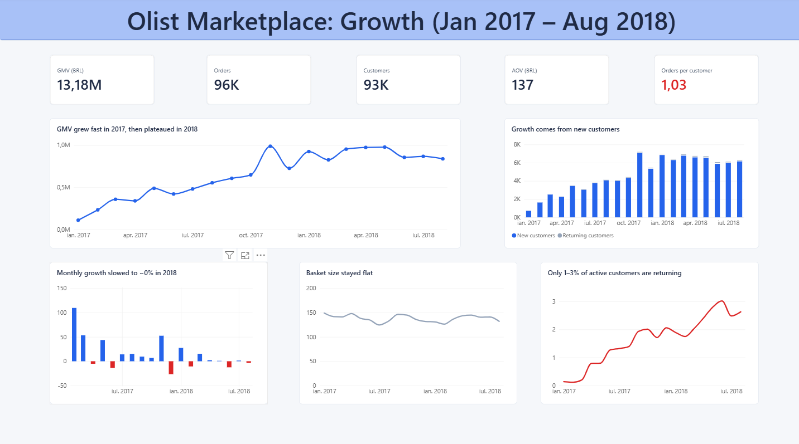
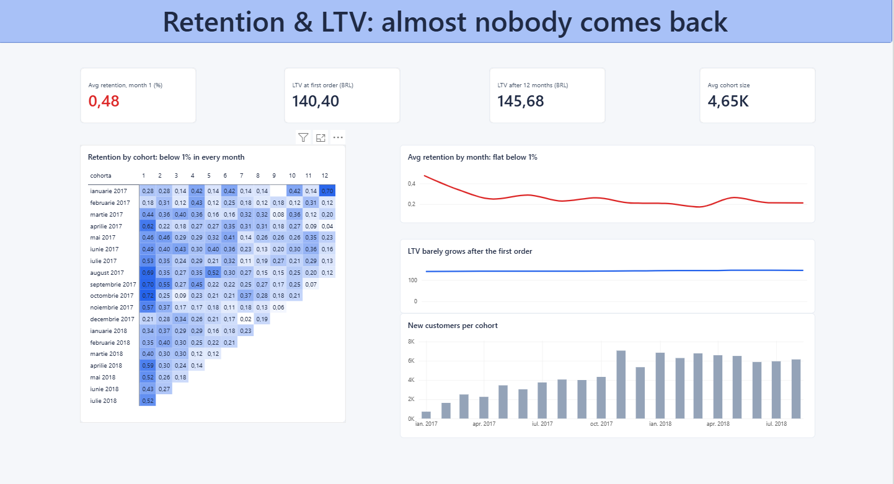
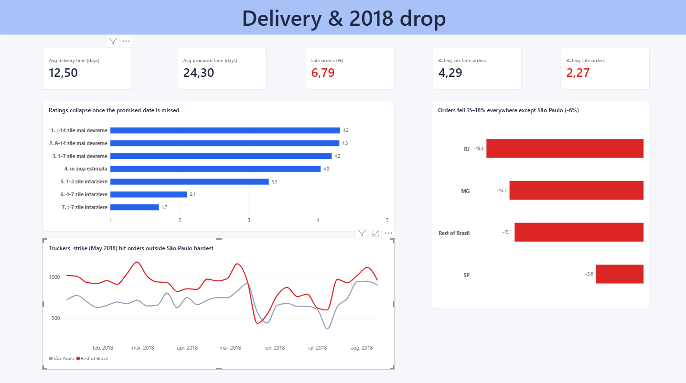

# Olist Marketplace Growth Analytics

End-to-end analysis of **~100,000 orders** from Olist, a Brazilian e-commerce marketplace (Jan 2017 – Aug 2018, currency **BRL**).
**Python** (ETL) → **SQL Server** (KPIs, cohorts, LTV, delivery analysis, metric-drop investigation) → **Power BI** (3-page dashboard).

**The question:** *How did the marketplace grow, why do customers not come back, and what caused the drop in orders in mid-2018?*

---

## 📊 Dashboard

### 1. Growth


### 2. Retention & LTV


### 3. Delivery & the 2018 drop


---

## 💡 Key findings

### 1. Growth came almost entirely from new customers
| KPI | Value |
|---|---|
| GMV (product value, excl. shipping) | **BRL 13.2M** |
| Delivered orders | **96,211** |
| Unique customers | **93,104** |
| AOV | **BRL 137** |
| Orders per customer | **1.03** |

GMV grew fast through 2017 and plateaued in 2018. AOV and order frequency stayed flat, so all of the growth came from acquiring new customers. Shipping adds about 17% on top of product value.

### 2. Retention is close to zero, so LTV ≈ the first order
- On average, only **0.48%** of a monthly cohort orders again in the following month, and retention stays **below 1% in every month** for every cohort.
- After 12 months, a customer is worth only **~3% more** than their first order (BRL 141.5 → 145.7 for the same cohorts).
- The one visible pattern is on the cohort diagonal: **Black Friday 2017** brought back customers from several older cohorts at once.
- Implication: almost all customer value comes from the first purchase, which caps how much can be spent on acquisition. Retention is the biggest opportunity.

### 3. Customers judge the delivery promise, not the speed
- Orders take **12.5 days** on average, but customers are promised **24.3 days**, so most orders arrive well before the estimate. **6.8%** arrive late.
- Ratings drop from **4.3** (on time) to **2.3** (late). Arriving 14 days early is rated the same as arriving 5 days early, but once the promised date is missed the score falls with every extra day, down to **1.7** after a week.
- Customers whose first order was late returned slightly less often within 180 days (**2.75% vs 3.15%**), but the difference is **not statistically significant** (z ≈ 1.5), because repeat purchases are so rare.
- Implication: estimates look padded. Olist could **A/B test shorter delivery estimates** to lift conversion, with late-delivery rate and review score as guardrails.

### 4. The 2018 drop was an external logistics shock
Orders per day fell **11.6%** from March to June 2018. Investigated step by step:
1. **Is it real?** No missing days, the drop appears across all order statuses, and the delivery rate did not worsen.
2. **When?** A sudden crash in the **week of 20 May 2018**: −38% in São Paulo and −54% in the rest of Brazil, matching the start of the national **truckers' strike** (21 May 2018).
3. **Where?** Orders fell **15–18% in every region except São Paulo (−6%)**, where most sellers are based. Every product category fell by a similar amount, so the driver was long-distance shipping, not demand for specific products.
4. **Which component?** Fewer **new customers**. AOV stayed stable.
5. **Recovery:** partial in June, full by late July 2018.

Recommendations: weekly regional order alerts, pausing paid acquisition in regions hit by logistics disruptions, and growing seller coverage outside São Paulo.

---

## 🧹 Data preparation (Python ETL)

`python/etl_olist.py`
- **Extract:** reads the raw Olist CSVs (the geolocation file is skipped).
- **Transform:**
  - converts date columns from text to datetime;
  - checks that missing delivery dates match undelivered order statuses;
  - checks for duplicate keys;
  - cleans product categories (missing → `unknown`, English translation joined, column names fixed).
- **Load:** writes 7 clean tables to SQL Server with `to_sql`, then checks that row counts match.

Key data decisions:
- **Customer = `customer_unique_id`.** In Olist, `customer_id` changes with every order, so using it would show zero retention.
- **Period: Jan 2017 – Aug 2018.** 2016 had very few orders and a missing month, and Sep–Oct 2018 were cut off when the data was extracted.
- **Delivered orders only**, and **GMV = product price** (shipping is analysed separately).
- Order items are aggregated per order before joining, so orders with several products aren't counted twice.

---

## 🏗️ Architecture

```
Raw CSVs ──► Python ETL (extract, transform, load) ──► SQL Server (7 tables)
                                                            │
                                                            ▼
                                                   Analytical views
                                                            │
                                                            ▼
                                                   Power BI dashboard
```

**SQL views** (`sql/Olist_Analysis.sql`)
| View | Purpose |
|---|---|
| `vw_kpi` | headline KPIs |
| `vw_month_trend` | monthly GMV, orders, customers, AOV, month-over-month growth (`LAG`) |
| `vw_clients` | new vs returning customers per month |
| `vw_cohort_retention` | monthly cohort retention |
| `vw_cohort_ltv` | cumulative LTV per cohort (running total) |
| `vw_delivery_kpi` | delivery time, promised time, late %, ratings |
| `vw_delivery_buckets` | rating by delay bucket |
| `vw_region_drop` | change in orders per day by region, March vs June 2018 |
| `vw_weekly_region` | weekly orders, São Paulo vs rest of Brazil |

SQL techniques used: CTEs, window functions (`ROW_NUMBER`, `LEAD`, `LAG`, running `SUM() OVER`, `MAX() OVER (PARTITION BY)`), conditional aggregation, cohort analysis, and a two-proportion z-test for significance.

---

## 📁 Files
- `python/etl_olist.py`: ETL pipeline
- `sql/Olist_Analysis.sql`: all SQL views and analysis queries
- `powerbi/Olist_Dashboard.pbix`: Power BI report
- `images/`: dashboard screenshots

## 🚀 How to run
1. Download the [Brazilian E-Commerce Public Dataset by Olist](https://www.kaggle.com/datasets/olistbr/brazilian-ecommerce) and unzip it into `data/raw/`.
2. In SQL Server, create an empty database: `CREATE DATABASE Olist;`
3. Update the server name in `etl_olist.py` and run it from the `python/` folder: `python etl_olist.py`
4. Run `sql/Olist_Analysis.sql` in SSMS.
5. Open the `.pbix` file and refresh the connection to your SQL Server instance.

## ⚠️ Limitations
- LTV is measured in **GMV**, not profit. Olist's commission isn't in the data.
- The link between the truckers' strike and the drop is based on **timing and geography**. Confirming it would need carrier or external market data.
- Delivery and retention are **correlations**. Late deliveries are more common in remote regions, which may also affect repeat purchases.
